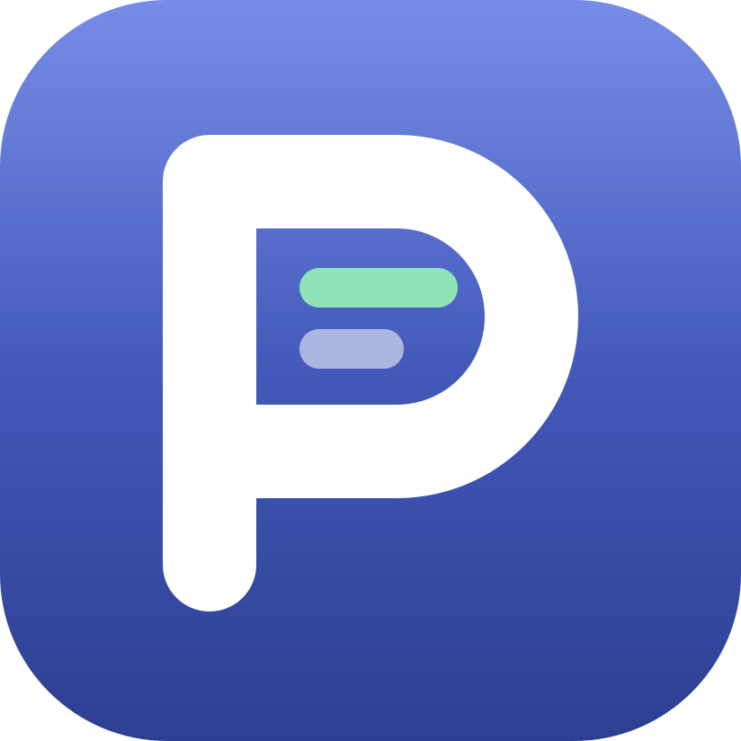
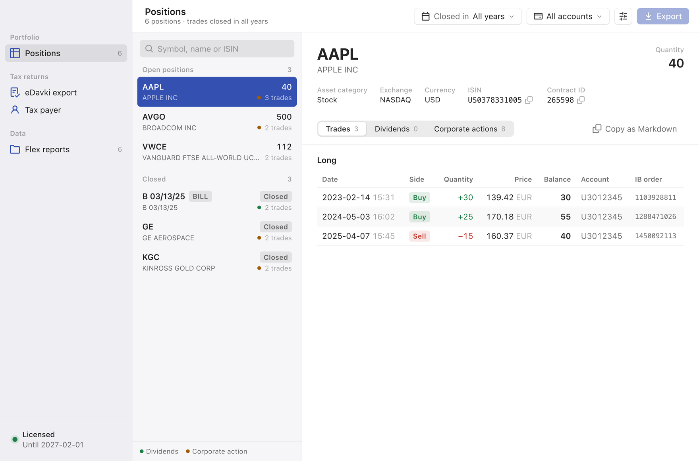

<p align="center">
  
</p>

<h1 align="center">Portfelj</h1>

<p align="center">
  Portfolio analysis and eDavki tax returns for Interactive Brokers.
</p>

<p align="center">
  <b>English</b> · <a href="README.sl.md">Slovenščina</a>
</p>

<p align="center">
  <a href="https://portfelj.net">Website</a> ·
  <a href="https://portfelj.net/get-the-app.html">Install</a> ·
  <a href="https://github.com/codebydre/portfelj/releases">Releases</a> ·
  <a href="CHANGELOG.md">Changelog</a>
</p>

---

Portfelj turns your Interactive Brokers flex reports into a clear picture of your portfolio and ready-to-file eDavki forms. Use it from the terminal today, or from the desktop app once it ships.

## Desktop app — coming soon

<picture>
  <source media="(prefers-color-scheme: dark)" srcset="assets/app-dark.webp">
  
</picture>

A native app for macOS, Windows and Linux built on the same engine as the CLI. Download flex reports, review your positions and export eDavki forms without opening a terminal.

> [!TIP]
> Watch this repository (**Watch → Custom → Releases**) to get notified when the app is released.

## Command line tool

Available now for Windows, macOS and Linux (x64 and ARM64).

```sh
# Download flex reports straight from IBKR
portfelj flex web-service download 2026

# View closing trades in 2026
portfelj ledger --tax-year 2026

# Generate eDavki forms
portfelj edavki --tax-year 2026
```

## Features

- **eDavki forms** generated from IBKR flex reports
- **Direct flex download** from IBKR, no manual exports
- **Corporate actions**: splits, reverse splits, mergers, spin-offs, issue changes, T-bill maturities
- **Account transfers** between IB accounts, including IB branch migrations
- **Migrating from another broker**: import transferred positions manually
- **Flex explorer** for searching securities and transactions in your reports

## Install

| Platform | Command |
|---|---|
| macOS | `brew install codebydre/portfelj/portfelj` |
| Windows | Download the `.msi` from [Releases](https://github.com/codebydre/portfelj/releases) |
| Ubuntu / Debian | Download the `.deb` from [Releases](https://github.com/codebydre/portfelj/releases), then `sudo dpkg -i portfelj_*.deb` |

See [portfelj.net/get-the-app](https://portfelj.net/get-the-app.html) for step-by-step instructions and how to verify installer signatures.

## Documentation

- [Setting up flex reports](https://portfelj.net/flex-reports.html)
- [Filing with eDavki](https://portfelj.net/edavki.html)
- [Corporate actions](https://portfelj.net/corporate-actions.html)
- [Transfers](https://portfelj.net/trade-transfers.html)
- [Activation](https://portfelj.net/activate.html)
- [Support](https://portfelj.net/support.html)

## License

Portfelj is proprietary software and requires activation. It's provided as is. Read the liability disclaimer shown on first run before relying on its output for your tax returns.
